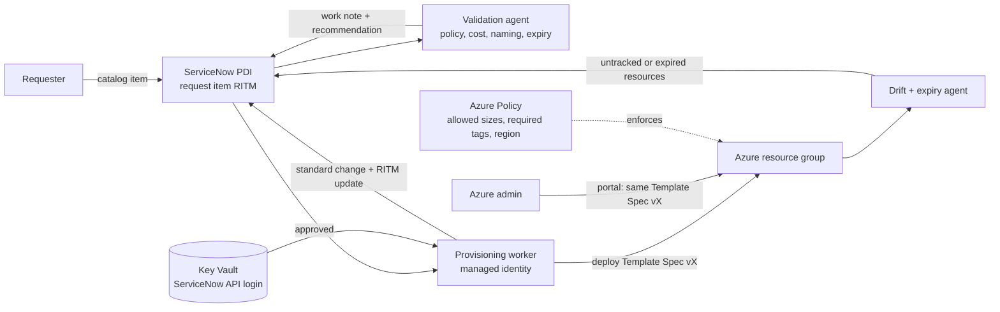

# Design: agentic self-service provisioning, ServiceNow catalog to Azure

Status: **agreed** (2026-11-19); decisions in section 9. Work starts after the change-management project's M4.
Third in a series:
- [incident triage and auto-remediation](https://github.com/asampath1/agentic-aiops-servicenow-azure) (v1.0)
- [change management](https://github.com/asampath1/agentic-change-management-servicenow)
- **request fulfilment** (this one)

## 1. Problem

Teams ask for cloud resources, such as a test VM or a storage account, through tickets or chat. Fulfilling them is
slow and inconsistent:
- **Sizes and costs** are picked by hand.
- **Tags and naming** are forgotten.
- **Approvals** happen in email.
- **Nobody deletes the resource** when the project ends.

When people can also create resources directly in the cloud portal, nobody knows which resources were approved.

## 2. What the project shows

Requests come through a **ServiceNow catalog**. An AI agent checks them against policy and cost, and a person
approves. A **single, versioned template** then creates the resource. The **same template** is also available
directly in Azure for administrators. Policy is enforced in Azure, so both paths follow the same rules.
Resources expire and are cleaned up. Anything created outside the process is detected.

## 3. Scope

| In | Out (for now) |
|---|---|
| 2 catalog items: **Linux test VM**, **Storage account** | Networking, databases, AKS, multi-subscription |
| One Bicep template per item, published as an Azure **Template Spec** (versioned) | Terraform; Azure Deployment Environments |
| Validation agent: allowed sizes, monthly cost estimate (public Azure Retail Prices API), naming, tags, purpose, expiry date (maximum 30 days) | Budget approvals across cost centres |
| Approval in ServiceNow; provisioning only after approval | Automatic approval |
| Each provisioning recorded as a **standard change**, linked to the request | Full CMDB discovery |
| **Expiry:** reminder, then automatic deletion (after a request or approval to delete) | Extending or resizing existing resources (maybe later) |
| **Drift check:** resources without a matching approved request are reported | Auto-deleting drift (report only) |
| Offline evaluation set of synthetic requests with known right answers | |

## 4. One template, two entry points

- **Bicep** source in the repo, `@allowed` on size and SKU. It is published with `az ts create` as a Template Spec
  version (`vm-linux-test@1.0`).
- **Portal path (admins):** *Template specs → Deploy*. A `createUiDefinition` gives a proper form.
- **ServiceNow path:** the worker deploys `templateSpecs/vm-linux-test/versions/1.0` with the request's parameters.
- **The same rules apply on both paths:**
  - Azure Policy on the resource group denies sizes outside the list, deployments missing the `request-id` and
    `expires-on` tags, and other regions.
  - Portal deployments by admins must use a request ID too; otherwise the drift check reports them.

## 5. Identities and secrets

| What | How |
|---|---|
| Worker → Azure | **System-assigned managed identity**, custom role on the sandbox resource group only (deploy, read, delete) |
| Worker → ServiceNow | ServiceNow API user's password in **Key Vault**, read by the managed identity; never in code, templates or the repo |
| VM access | **Entra ID login** (or the requester's SSH public key, from the catalog form). No passwords |
| Key Vault access | RBAC: the worker reads secrets; only the admin can write them |

## 6. How ServiceNow and Azure connect: pull, not push

**ServiceNow never connects to Azure.** A worker in Azure pulls approved requests from ServiceNow:
1. A person approves the request in ServiceNow. Nothing leaves ServiceNow.
2. Every few minutes the worker asks the ServiceNow API for approved, not-yet-built requests. It logs in as the
   ServiceNow API user, whose password it reads from Key Vault.
3. It deploys the Template Spec with its managed identity (no secret).
4. It writes the result back: it updates the request and records a standard change.

So ServiceNow holds **no Azure credentials**, and Azure holds one ServiceNow secret, in Key Vault.

| | Pull (chosen) | Push (alternative) |
|---|---|---|
| Azure secrets in ServiceNow | None | An Entra ID service principal secret or certificate, in a ServiceNow credential record |
| Speed | Up to the polling interval (5 min) | Instant on approval |
| Pattern | Common where security wants no inbound credentials | ServiceNow's product approach (IntegrationHub Azure spoke, Cloud Provisioning) |
| Effort on a PDI | Low; same tools as v1 | App registration, REST/OAuth setup in ServiceNow, secret rotation; the Azure spoke may not be available on a free PDI |

An enterprise would choose push when instant provisioning matters and ServiceNow is the system of record for
cloud credentials. A middle option is ServiceNow calling an Automation webhook on approval: instant, with no Azure
login, but the webhook URL becomes a secret in ServiceNow. The write-up will cover these choices.

## 6b. Where the worker runs

| Option | Pros | Cons |
|---|---|---|
| **A. Azure Automation runbook** on a schedule (polls approved RITMs every 5 min) | Proven on this trial in v1 (here in Japan West: trials allow six regions, one account each); managed identity; Key Vault access built in | PowerShell; polling delay |
| B. Logic App (consumption) | Proven in v1; has ServiceNow and ARM connectors; visual run history for demos | Logic in JSON; harder to test |
| C. Python worker run locally (like the agents) | Simplest; same language as the agents | Not "real" automation; needs my login |

**Chosen: A** for provisioning and expiry, with the AI agents in Python (validation and drift), run like the other
projects.

## 7. Evaluation

A synthetic set of about 40 catalog requests with known right answers:
- approve, approve with changes (e.g. smaller size), or reject;
- missing information;
- a cost estimate within ±10%;
- policy breaches.

Metrics:
- **wrong approvals** (the safety metric; target 0);
- decision accuracy;
- cost-estimate error;
- for drift detection, precision and recall on a seeded set of untracked resources.

## 8. Plan and the Azure deadline

The Azure trial ends **mid-December 2026**, so the live Azure parts must be **done by about 10 December**.

| # | Deliverable | Needs |
|---|---|---|
| P1 | Bicep templates + Template Specs + Policy + Key Vault + worker identity (`infra/`). **Deployed 2026-11-19** | Azure |
| P2 | ServiceNow catalog items, variables, approver group and approval rules on the PDI (`servicenow/catalog.py`, [details](../servicenow/README.md)). **Done 2026-11-20**: verified with a request ordered as a synthetic employee and approved by the cloud team | PDI |
| P3 | Validation agent + synthetic request set + scoring ([policy](request-policy.md), [results](../evaluation/README.md)). **Done 2026-11-20**: heuristic 4 of 17 wrong approvals, with Claude reading rule 7: 0 of 17 ($0.04) | offline |
| P4 | Provisioning worker: approved RITM → Template Spec deployment → change record + RITM update (`infra/runbooks/RB-Provision-Requests.ps1`). **Done 2026-11-20**: RITM0010005 built as `vm-test-ritm0010005`, recorded as CHG0030412 | Azure + PDI |
| P5 | Expiry worker (`infra/runbooks/RB-Expire-Resources.ps1`) and drift agent (`agents/drift.py`). **Done 2026-11-23**: drift 0 of 18 missed offline, live test caught a portal deployment (INC0010898); live expiry of `vm-test-ritm0010005`: reminder 22 Nov, deletion approval 23 Nov, approved by the requester, deleted and recorded as CHG0030413 | Azure + PDI |
| P6 | Live demo (one VM requested → validated → approved → built → expired → deleted), write-up, overview. **Done 2026-11-23**: RITM0010006 end to end ([live demo](live-demo.md), expiry dates simulated with `-AsOf`); platform resource-group guard policy; stage set by a business rule | both |
| — | **Teardown:** delete the resource group, the Template Specs, the policy assignment and the custom role | Azure |

## 9. Decisions (2026-11-19)

1. **Name:** `agentic-provisioning-servicenow-azure`.
2. **Catalog items:** Linux test VM and storage account.
3. **Portal path:** admins only. Portal deployments must carry a `request-id` tag (enforced by Policy); anything
   untracked is reported as drift.
4. **Connection:** pull. The Azure Automation runbook polls ServiceNow and uses a managed identity for Azure and
   Key Vault for the ServiceNow login (section 6).
5. **Expiry:** reminder 3 days before. At expiry, the resource is deleted once the owner confirms, or after a 2-day
   grace period with no reply. Every deletion is recorded as a standard change.
6. **Change record (changed 2026-11-20):** each build is recorded with the PDI's **Change Registration** model
   ("a record of an automated change", no approvals) instead of a standard change, which would need a hand-built
   template. The model keeps its own short description and group; the request number is in `correlation_display`.
7. **Polling (changed 2026-11-20):** hourly, plus on demand (`az automation runbook start`), not every 5 minutes.
   Automation schedules cannot run more often than hourly, and 15-minute runs would exceed the free job minutes.
8. **The worker only builds what the agent recommended.** A person's approval of a request the validation agent
   flagged reject or needs-information is not built ("blocked"); every value is re-checked against the policy
   before deploying, and Azure Policy checks again.
9. **Before P1:** check the remaining trial credit (Azure portal → Subscriptions → Cost analysis / Credits).
