# Live demo: one VM from request to deletion (P6)

On 2026-11-23 I ran the whole flow once, live, on the ServiceNow PDI and the Azure sandbox: a synthetic employee
ordered a Linux test VM, the validation agent checked it, a person approved it, the worker built it, and the expiry
worker reminded the owner, asked for confirmation and deleted it. All people and data are synthetic (fictional
company ShopKart Retails).

**One thing is simulated: the dates.** The VM expired on 2026-11-30, but I ran the expiry steps on the same day
with `-AsOf 2026-11-29` (reminder) and `-AsOf 2026-11-30` (deletion approval, deletion), and with a 1-day reminder
and grace period instead of the default 3 and 2. Everything else is real: the request, the approvals, the Azure
resources and their deletion. The same steps ran on real dates in P5 (RITM0010005: reminder on 22 November, deletion
on 23 November; see [infra/README.md](../infra/README.md#expiry-worker-p5)).

| Step | Who | Record |
|---|---|---|
| 1. Order "Azure Linux test VM" in the portal | Aditya Banerjee (synthetic employee) | RITM0010006 |
| 2. Check against the 7 policy rules, estimate the cost | validation agent | work note: Approve, $6.18/month |
| 3. Approve | SKR Cloud Platform team (the PDI admin) | approval |
| 4. Build from the Template Spec, record the change | provisioning worker (Azure Automation, managed identity) | `vm-test-ritm0010006`, CHG0030414 |
| 5. Remind the owner (as of 29 Nov) | expiry worker | comment to the requester |
| 6. Ask the owner to confirm the deletion (as of 30 Nov) | expiry worker | approval for the requester |
| 7. Confirm | Aditya Banerjee | approval approved |
| 8. Delete, record the change, close the request | expiry worker | CHG0030415, Closed Complete |
| 9. Check for drift | drift agent | no drift |

## 1. The order

The requester fills in the catalog item: purpose, size (only the two sizes the sandbox allows are offered without
justification), SSH public key, expiry date (at most 30 days) and a justification.

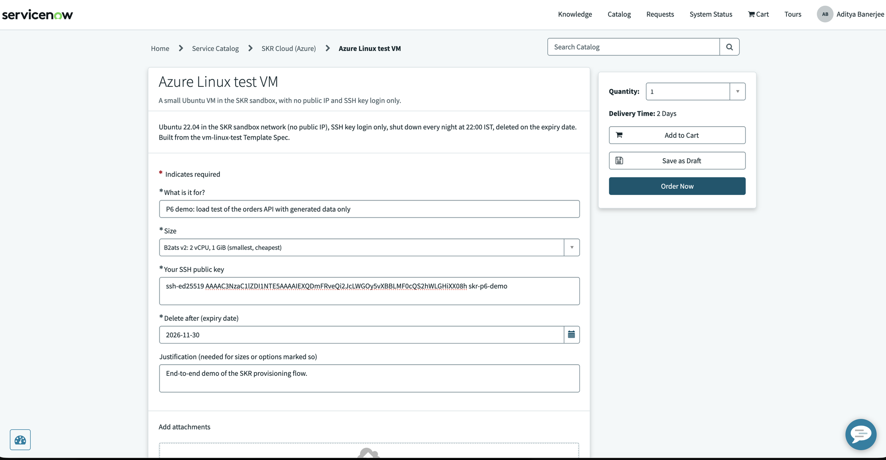

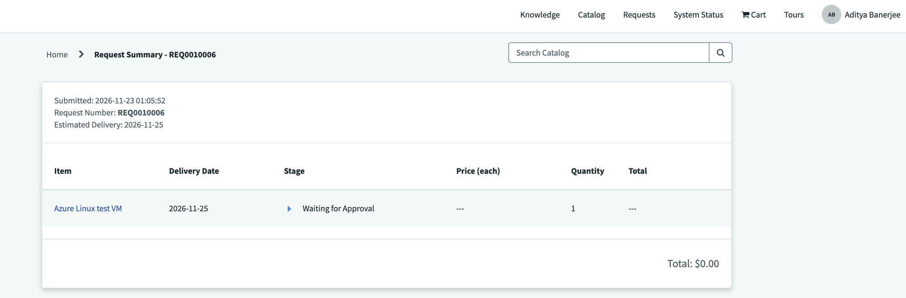

## 2. Validation and approval

The validation agent reads requests waiting for approval and writes a recommendation as a work note, with the
estimated monthly cost from the Azure retail price list. It only recommends; the cloud team decides, and the
requester cannot approve their own request (separation of duties).

```bash
python -m agents --source servicenow --write --out runs/p6-validate
```

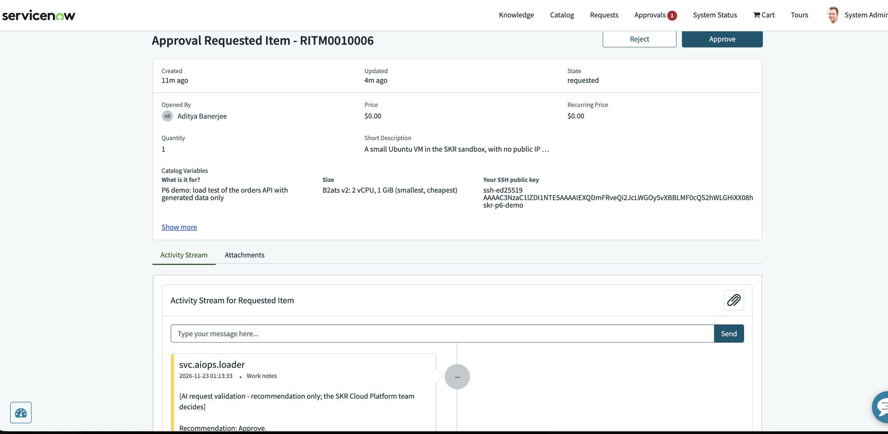

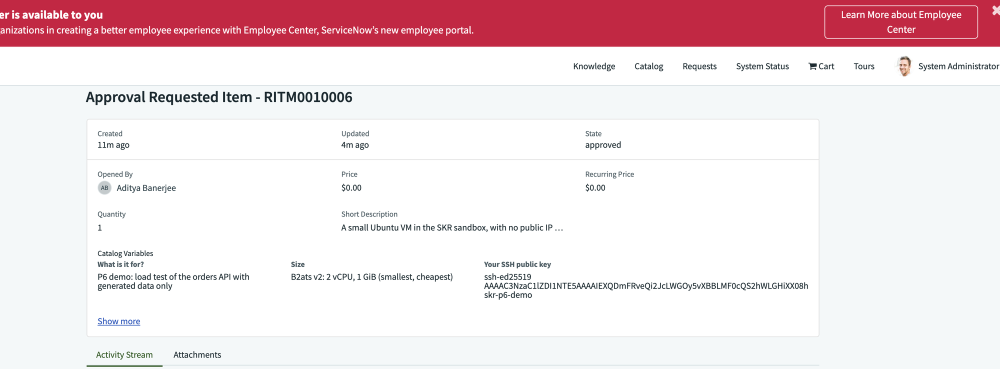

The Claude reader (`--reasoner claude`) did not take part in this run: the API key in that terminal was rejected
(401), and the reader fell back to the policy regexes for rule 7, as designed. The recommendation is the same
either way for this request, but a silent fallback hides a broken key, so a rejected key now stops the run.

## 3. The build

The provisioning worker is an Azure Automation runbook. It pulls approved requests from ServiceNow (ServiceNow holds
no Azure credentials), re-checks the values against the policy, deploys the `vm-linux-test` Template Spec into the
sandbox with its managed identity, records the build as a change (model Change Registration) and leaves the request
open (Work in Progress, stage Delivery) while the VM exists.

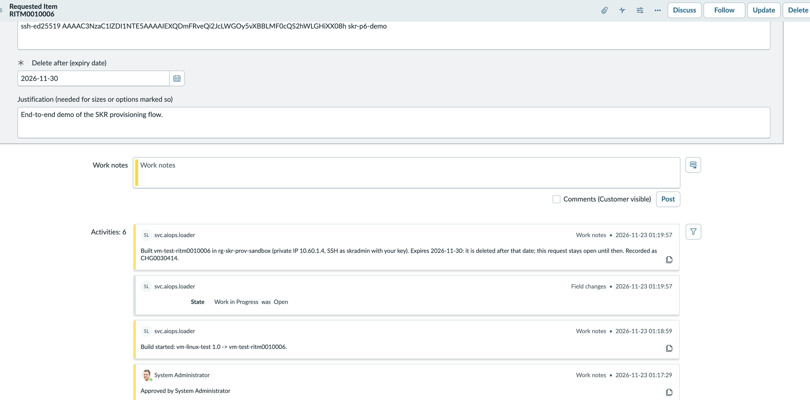

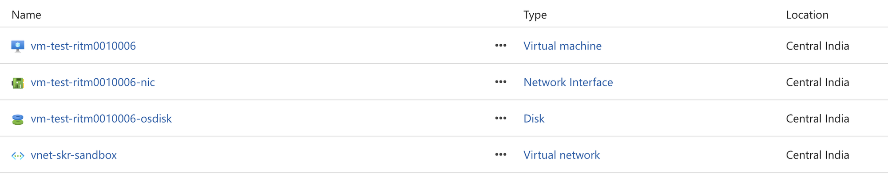

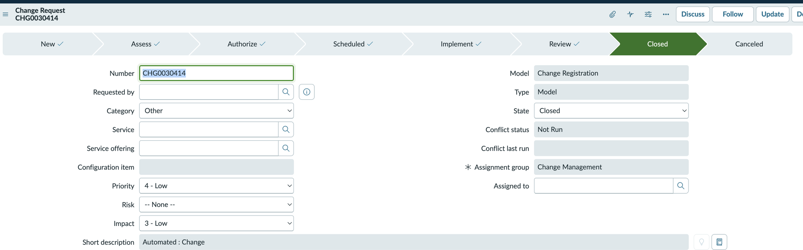

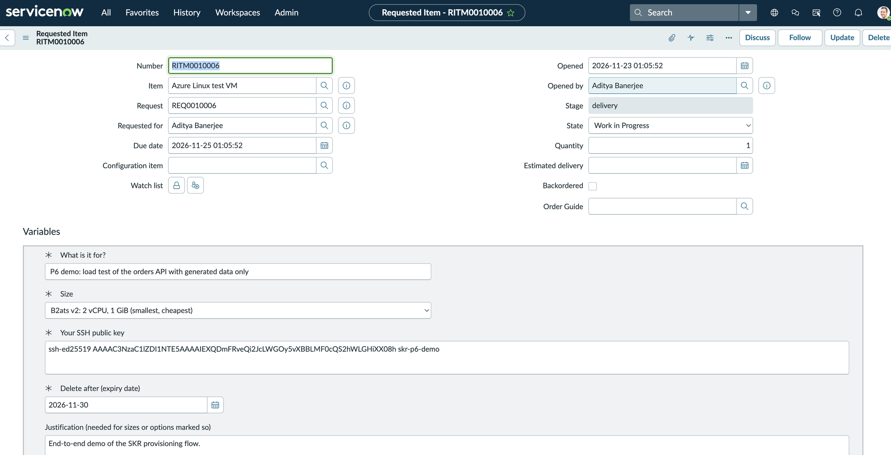

## 4. Expiry: reminder, confirmation, deletion

```bash
az automation runbook start -g rg-skr-prov-platform --automation-account-name aa-skr-prov -n RB-Expire-Resources \
  --parameters ReminderDays=1 GraceDays=1 AsOf=2026-11-29      # then AsOf=2026-11-30, twice
```

The reminder goes to the requester as a comment they see in the portal:

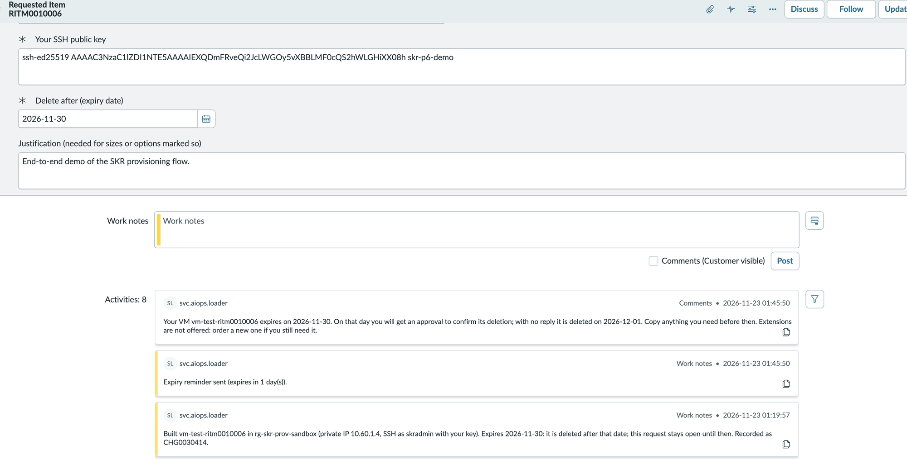

On the expiry date the requester gets an approval, "Delete VM vm-test-ritm0010006?". With no reply, the VM is
deleted when the grace period ends; nothing is deleted before the owner has been asked.

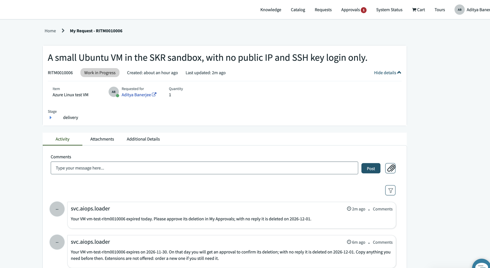

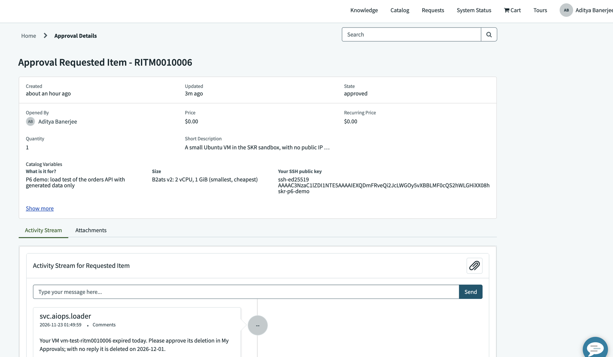

The next run deletes the VM (its disk and NIC go with it) and the auto-shutdown schedule, records the deletion as a
change and closes the request:

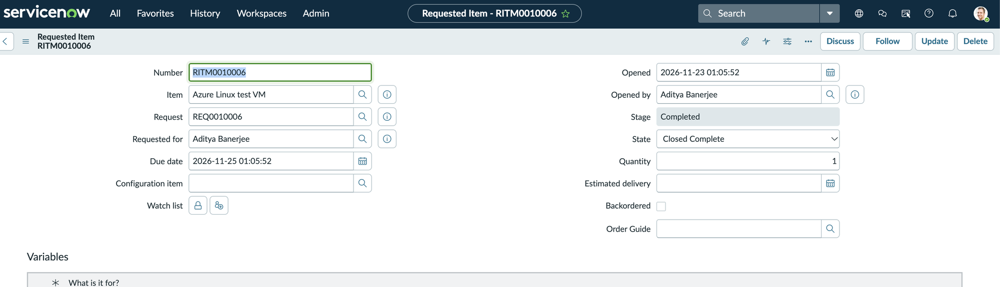

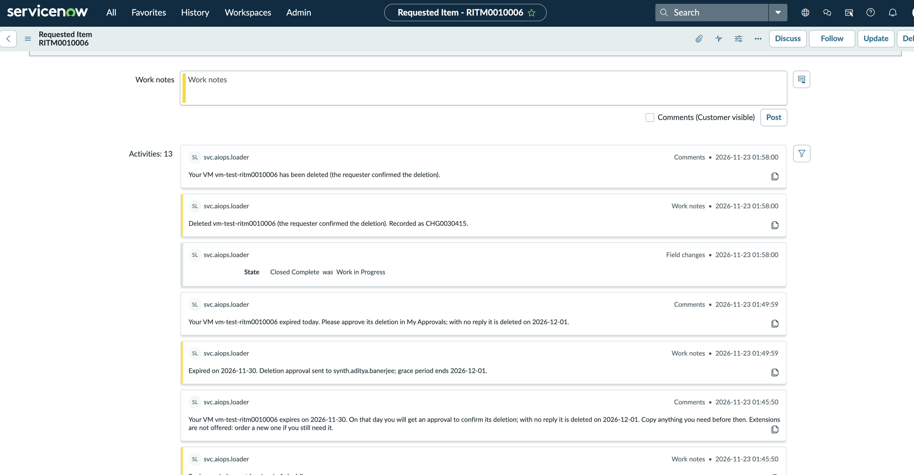

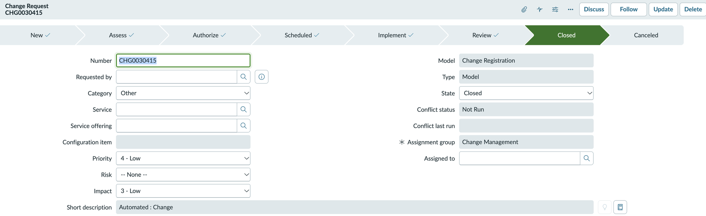

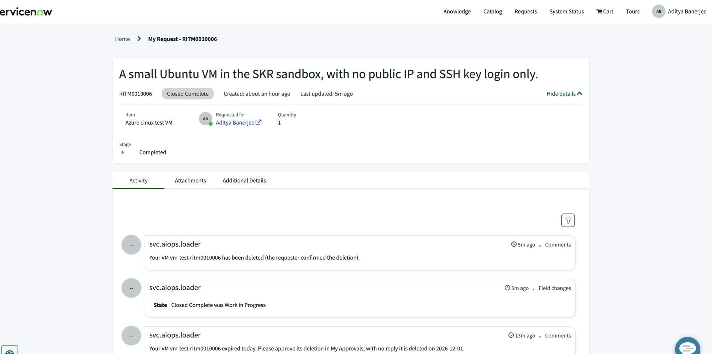

## 5. Azure afterwards

Only the sandbox network is left, and the Activity log shows that the worker's managed identity (`aa-skr-prov`)
deleted the VM. The drift agent, which compares the sandbox with ServiceNow, found nothing out of place.

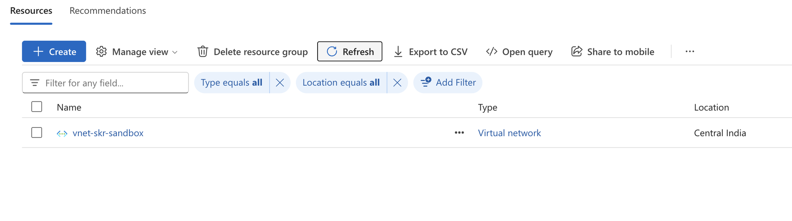

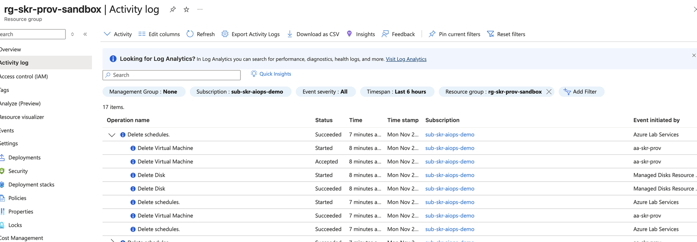

## What the live runs taught me

Each of these was found on the PDI or in Azure, not in the offline tests:

1. **A request for a temporary resource must stay open while the resource exists.** I first closed it after the
   build. ServiceNow's out-of-box rule "Moot Approvals Upon Cancellation" then marked the deletion approval "not
   required" the moment it was created, so the owner could not confirm. The request now closes on deletion.
2. **The owner needs approval rights.** Approvals for users without the `approver_user` role are not actionable;
   the catalog setup grants it to requesters.
3. **ServiceNow ignores `stage` written over the REST API.** A business rule sets it from the provisioning state
   (Delivery while in use, Completed after deletion). The portal's stage list follows the PDI's out-of-box catalog
   flow and does not change.
4. **The portal's Template Spec form deploys into the Template Spec's own resource group by default,** where none of
   the sandbox policies applied. A policy now denies VMs and storage accounts there, and the drift agent reports
   request-tagged resources anywhere outside the sandbox.
5. **Azure capacity is not guaranteed** (AllocationFailed on the first build in P4): the worker marks the request
   failed with Azure's message and retries on request.
6. **Check what you read back.** The expiry worker reads the approval back after creating it and says so in a work
   note if ServiceNow did not leave it Requested; that is how I found item 1 within minutes.
